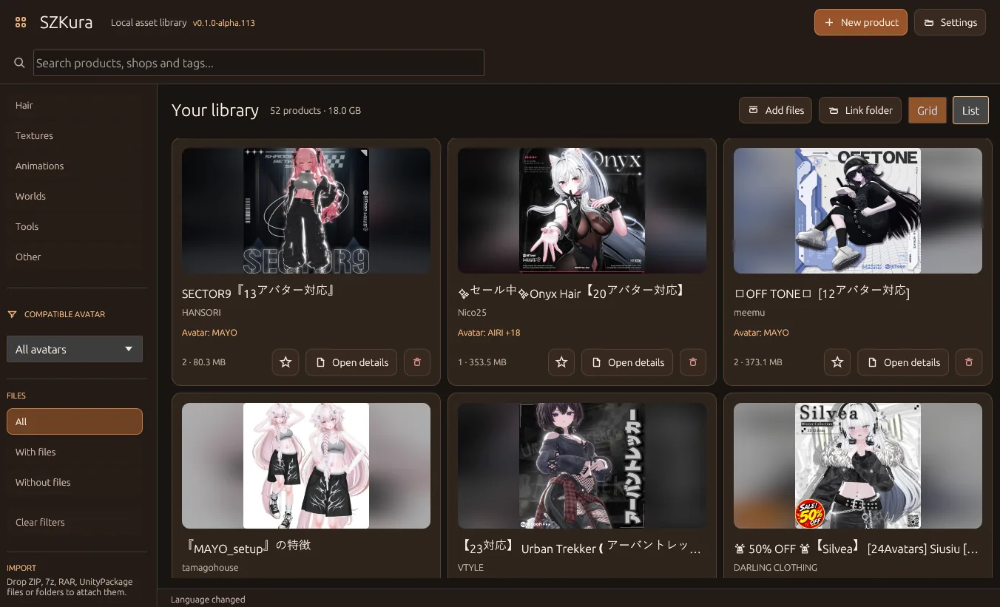
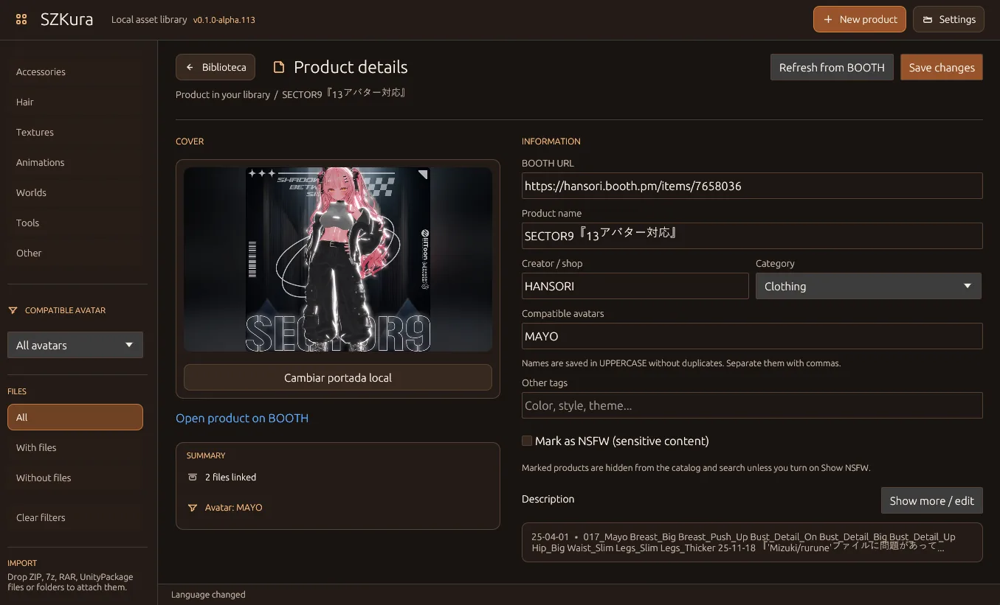
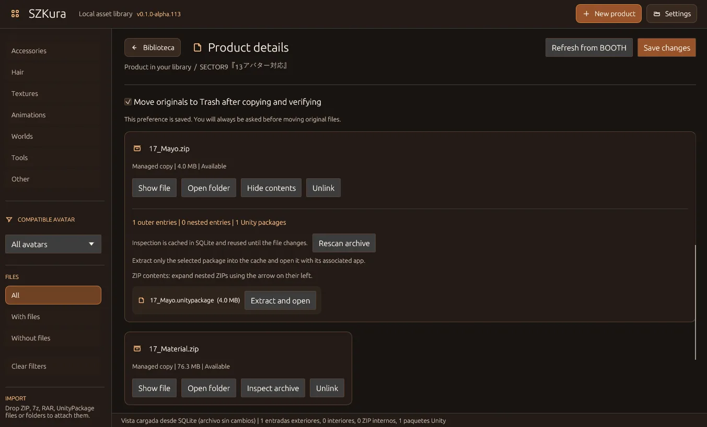
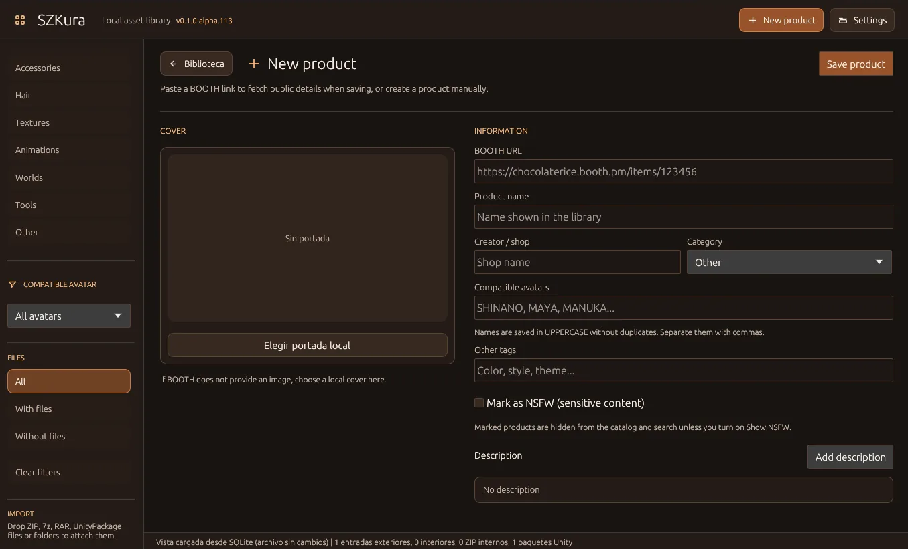
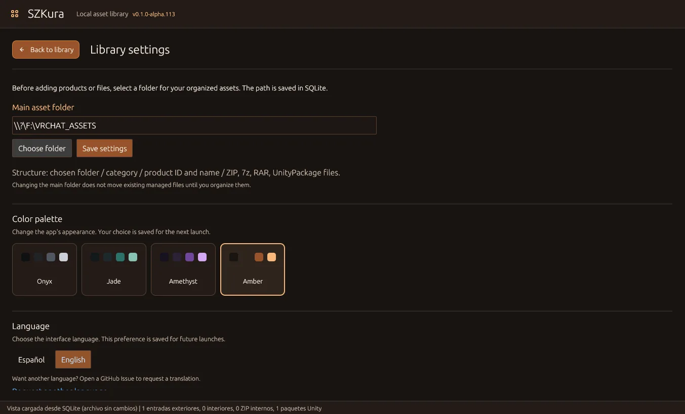

# SZKura

**A local asset library for BOOTH and VRChat.**

SZKura is a lightweight desktop app for keeping track of your [BOOTH](https://booth.pm/) purchases, avatars, outfits, textures, accessories, and Unity packages. Built with **Rust, egui, and SQLite** — with no account or cloud library required.

## Features

- Product cards with covers, creator names, tags, favorites, categories, and compatible avatars.
- Import or link `.zip`, `.7z`, `.rar`, and `.unitypackage` archives. Inspect files inside archives and selectively open Unity packages.
- Fetch public BOOTH product details and cover images, or create entries manually.
- Search and filter your library, including NSFW visibility, linked files, and total linked-file size.
- Fast, optimized WebP covers, blurred backgrounds, and four selectable color palettes.
- **English and Spanish UI**, with a saved language preference in Settings.
- Local SQLite data, optional managed storage, and portable `.szkura` backups.

## Screenshots

Screenshots of the SZKura desktop interface with English selected. The interface is also available in Spanish.

### Library



<details>
<summary><strong>Product details</strong></summary>

View and edit BOOTH product metadata, linked files, compatible avatars and covers.



</details>

<details>
<summary><strong>Archive inspector (ZIP, 7z, RAR)</strong></summary>

Browse archived files and selectively extract Unity packages without unpacking the full library.



</details>

<details>
<summary><strong>New product</strong></summary>



</details>

<details>
<summary><strong>Settings and languages</strong></summary>



</details>

## Download and installation

Choose a pre-release from **[GitHub Releases](https://github.com/ShxwZ/SZKura/releases)**. New releases include both **Windows x64** and **Linux x64** binaries.

### Windows

1. Download `SZKura-win-x64.exe` from the most recent release.
2. Run the executable; no separate installer is required.
3. Open **Settings** to choose your asset directory. Your library and preferences are loaded automatically.

If Windows SmartScreen warns about an unsigned application, verify the download came from the project's official GitHub release before proceeding.

### Linux (x86_64)

1. Open **[Releases](https://github.com/ShxwZ/SZKura/releases)** and download `SZKura-linux-x64` from the latest build. GitHub may not show prereleases under its “Latest” shortcut.
2. Open a terminal in your Downloads directory and make the file executable:

```bash
cd ~/Downloads
chmod +x SZKura-linux-x64
./SZKura-linux-x64
```

On Linux, run SZKura in a graphical X11 or Wayland session. A working desktop portal is recommended for the file chooser. If needed, install the matching graphical runtime dependencies for your distribution.

You can optionally move the binary somewhere in your `PATH` (for example `~/.local/bin/szkura`). Linux releases are portable executables; they do not install desktop menu shortcuts automatically.

### Build from source (Windows or Linux)

Install a recent stable [Rust toolchain](https://rustup.rs/). On Ubuntu/Debian, install the libraries used by CI before building:

```bash
sudo apt-get update
sudo apt-get install -y libxcb-render0-dev libxcb-shape0-dev libxcb-xfixes0-dev \
  libxkbcommon-dev libssl-dev pkg-config libwayland-dev
git clone https://github.com/ShxwZ/SZKura.git
cd SZKura
cargo build --release
```

On Windows, use your installed Rust toolchain and run `cargo build --release` in the cloned repository. The resulting binaries are `target/release/szkura.exe` on Windows and `target/release/szkura` on Linux.

## Getting started

1. Open **Settings** to configure the folder for organized assets and select **Español** or **English**.
2. Choose **New product** and paste a BOOTH URL, or fill in the details manually.
3. Attach local archives or a folder. Existing files can stay in their original locations.
4. Use search and filters to find products; open an entry to inspect archives.

A `.szkura` backup includes SQLite catalog data and local covers, **not the original asset archives**.

## Languages and translations

SZKura currently supports **English and Spanish**. **Requests for additional languages are welcome!** Open a [GitHub Issue](https://github.com/ShxwZ/SZKura/issues/new) and tell us which language you would like. Translation contributions are welcome as well.

## Notes

- SZKura uses **public BOOTH product information** when the website permits it. It does not log in to BOOTH or download paid assets.
- Encrypted, multipart, or unsupported archives might not open.
- Only import Unity packages from sources you trust; they can contain scripts.
- SZKura is independent and **not affiliated** with BOOTH, pixiv, VRChat, or Unity.

## License

[MIT License](LICENSE).
